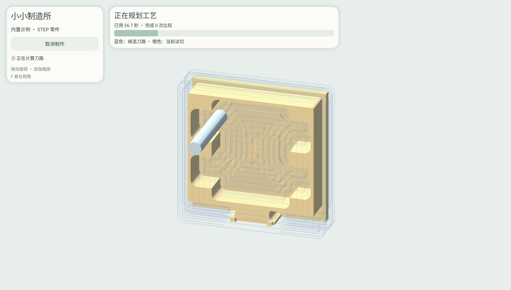

# Little Mill

A browser-based manufacturing simulation demo built with Godot.

[Try the demo](https://eric-schecter.github.io/little-mill/)

## Features

- Automatic process planning and toolpath generation for the built-in STEP sample.
- Material-removal simulation with tools, fixtures, workpiece indexing and reclamping.
- Playback speed controls, fast preview and toolpath visibility controls.
- Finished-part inspection and comparison with the target model.
- Rotate, pan and zoom the 3D view.

Runs in the browser using WebAssembly, with no native processing server required.
Use a recent desktop browser. This is an experimental demo, not machine-control software.

## Open-source dependencies

- **Godot Engine / godot-cpp** — application, rendering and C++ bindings; MIT.
- **Manifold** — solid modeling and material-removal booleans; Apache-2.0.
- **Clipper2** — 2D polygon clipping and offsets for toolpaths; Boost Software License 1.0.
- **OpenCAMLib** — surface-machining toolpath calculations; LGPL-2.1-or-later.
- **Boost** — supporting C++ libraries; Boost Software License 1.0.
- **Emscripten** — C++ to WebAssembly build toolchain; MIT / University of Illinois/NCSA.
- **Noto Sans CJK SC** — interface font; SIL Open Font License 1.1.

## License notices

Third-party licenses and attributions are preserved in [license notices](site/licenses/index.html).
OpenCAMLib's corresponding source, object files and static libraries for relinking
are available in [relink/](relink/), with instructions and applicable permissions
in [relink/README.md](relink/README.md).

This repository distributes the Web demo and required third-party materials.
No blanket license is granted for project-specific code. Component versions and
export checksums are recorded in [BUILD.json](BUILD.json).
